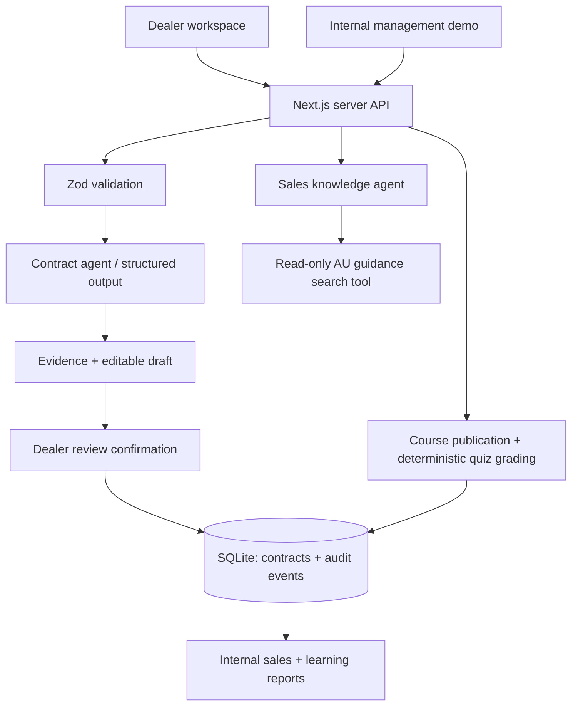

# 1단계 — 딜러 업무와 AI의 경계

이 저장소는 호주 현대차 딜러 업무를 가정한 독립 면접 프로토타입입니다. 현대차 공식 시스템, 공식 교육과정, 제품 가격·사양을 재현한 것이 아닙니다. 제공된 Word 문서는 교육 설계 참고 자료이고 문서 안의 Salesforce·UK 구현 지시는 이번 구현의 지시가 아닙니다.

## 이 단계에서 배울 것

화면을 잘 만드는 것과 엔드투엔드 시스템을 설계하는 것은 다릅니다. 요청, 모델, 검증, 사람의 판단, 저장, 관리자 지표 사이에 경계를 두고 각각 실패했을 때의 동작을 설명할 수 있어야 합니다.

**현재 구현:** 전문 에이전트 두 개를 API에서 직접 선택해 실행. 에이전트 간 handoff는 아직 없고 DMS, Salesforce, OpenAI file search는 연결되지 않았습니다. 현재 검색 도구는 작은 버전 고정 교육 자료에 대한 키워드 검색이며 벡터 RAG가 아닙니다.

## 옵션 → 선택 → 이유 → 대가

| 결정 | 옵션 | 현재 선택과 이유 | 대가 / 전환 조건 |
|---|---|---|---|
| 앱 경계 | 별도 Python API / Next.js 서버 | Next.js + TypeScript: 요청과 스키마를 한 코드베이스에서 추적 | 문서량 증가 시 별도 worker와 queue로 추출 분리 |
| 저장 | JSON / SQLite / PostgreSQL | SQLite: 계약과 감사 이벤트를 한 트랜잭션으로 저장 | 로컬 단일 인스턴스용. 운영은 PostgreSQL + tenant RLS |
| AI 추출 | OCR + 규칙 / 멀티모달 모델 | Agents SDK + schema output: JPG·PNG·PDF를 하나의 인터페이스로 처리 | 실제 필드 정확도는 API 키·검수한 계약 데이터셋으로 평가 필요 |
| 모델 | 소형 모델 / 대형 모델 | 기본 gpt-4.1-mini: 비용과 응답시간을 비교하기 위한 초기 가설 | 최적이라는 검증 결과 없음. Evals 후 확정, 환경변수로 교체 |
| 검색 | 전체 문맥 / 키워드 / managed file search | 초기에는 명시적인 AU 교육 자료 + 키워드 검색 | 승인된 AU 문서 확보 후 file search와 시장·유효기간 필터 도입 |
| 점수 | LLM에게 점수 계산 / 결정적 코드 | 퀴즈는 정답키로 서버에서 채점 | 역할극은 별도 근거 추출 + 코드 합산으로 확장 |
| 멀티에이전트 | 하나의 거대 agent / 전문 agent | 추출과 지식 응답 역할 분리. 쓰기 도구 없음 | 이후 실제 위임이 필요한 예약 시나리오에 orchestrator 추가 |
| 원문 보관 | 파일 보관 / 임시 처리 | 원문 업로드는 메모리 처리 후 보관하지 않음 | 검토 시 원문 재열람 불가. 운영은 암호화 객체 저장소 + 만료 정책 |

## 코드로 설명하는 요청 흐름

1. `app/page.tsx`: 계약서 검토 화면에서 Opportunity를 선택.
2. `app/api/contracts/route.ts`: 크기와 파일 시그니처를 검사. API 키가 없으면 503으로 이유를 알림. 업로드를 예제 추출로 대체하지 않음.
3. `lib/ai.ts`: 읽기 전용 추출 전문 agent가 nullable 필드와 인용문을 반환. 원문 속 지시를 따르지 않도록 지시하지만, 이것만으로 prompt injection이 해결된 것은 아님.
4. 딜러가 필드를 수정하고 검토를 확인. 서버가 필수 필드, VIN, 날짜, 금액 관계를 검사.
5. `lib/db.ts`: 계약과 감사 이벤트를 원자적으로 저장. 감사 기록은 동작과 ID만 포함. 수정 전후의 원문 PII를 로그에 남기지 않음.
6. `app/admin.tsx`: 계약 레코드와 Opportunity를 함께 보여주며 파이프라인과 검토 문서 금액을 구분.

Structured Outputs는 JSON 형식과 스키마 준수에 도움을 줍니다. 사실 정확도, 인용의 진실성, 서명의 진위나 법적 효력을 보장하지 않습니다. 현재 인용은 모델 출력이며 원문과 자동 대조되지 않았습니다.

## 관리자와 딜러

왼쪽 Dealer / Hyundai internal 전환은 **UI 데모**입니다. API에 인증·인가가 없고 learner는 가상 Jamie Taylor로 고정됩니다. 관리용 GET은 정답키도 반환합니다. 실제 서비스에서는 SSO, 세션, RBAC와 dealer_id 기반 객체 단위 권한 검사 후에만 허용해야 합니다. 클라이언트 역할 선택을 보안 경계로 사용하면 안 됩니다.

관리자는 텍스트 교육 자료와 3문항 퀴즈를 게시합니다. 딜러는 게시된 과정을 열고 퀴즈를 제출합니다. 과정 열람 이벤트와 모든 점수 시도는 SQLite에 저장됩니다. 브라우저 새로고침 후에도 관리자 보고서에서 확인할 수 있습니다. 자료 열람은 학습 완료의 증거가 아니고, 3/3은 지식 확인 통과이며 현대차 공식 수료·인증이 아닙니다.

## 면접에서 방어할 경계

- API 키는 서버 전용. 브라우저 번들에 포함하지 않음.
- SDK tracing을 끄는 것은 **Zero Data Retention을 의미하지 않음**. ZDR은 계정 계약과 사용 endpoint·도구의 적격성 확인이 필요.
- 현재 실제 고객 데이터를 취급할 준비가 안 됨. 로컬 가상 자료만 사용. 운영 전 인증, 보존·삭제, 암호화, 감사 주체, 레이트 제한, 파일 악성코드 검사, 문서 처리 격리가 필요.
- 추출 agent는 저장 도구를 갖지 않음. 검색 agent는 읽기 도구만 가짐. 프롬프트 방어보다 중요한 것은 권한과 쓰기 경계.
- 모델 호출은 동기식. 아직 작업 큐, 재시도 정책, 토큰 비용/지연 대시보드나 실측 SLO가 없음.
- 문서 금액 합계는 매출이 아님. 중복 계약, 취소, 납차와 세금 반영 전에는 revenue라고 주장하지 않음.

## 다음 구현 순서

1. 가상 AU 계약 이미지/PDF 골든셋으로 실제 추출 평가: 필드 정확도, null 정확도, 금액 완전 일치, 수정률, p50/p95 지연, 요청 비용.
2. 승인된 호주 제품·프로모션 문서를 확보하고 file search 도입. 국가·트림·문서 버전·시행일을 유지. 재고는 문서 RAG가 아니라 DB/API 조회.
3. 판매 coordinator → 지식 agent → 예약 agent 위임. 예약은 슬롯 제안 → 사용자 확인 → 서버 검증 → idempotency key로 DMS mock 생성. 모델 텍스트만으로 예약 완료를 표시하지 않음.
4. 역할극 customer agent와 rubric evaluator를 분리. 발화 인용·턴 ID를 근거로 추출하고 점수는 서버 계산. 재학습과 시도 비교.
5. 이미지 질문 확장. 외관 사진만으로 정확한 수리비나 감가율을 확정하지 않음. 관찰 가능한 손상, 불확실성, 전문가 검토 경로를 제시하고 실제 견적 데이터로 별도 검증.

## C-level 스토리

문제: 상담 준비·문서 재입력·교육 확인에 시간을 쓰는 딜러.
해결: AI가 초안을 만들고 사람이 거래 책임을 유지하는 연결된 업무 흐름.
데모: 계약 검토 → Opportunity 연결 → 관리자의 가시성 → 학습/퀴즈 → 교육 성과.
측정: 재입력 소요시간, 필드 수정률, 검토 완료율, 퀴즈 참여·재시도, 상담 준비 시간.
기대효과는 가설입니다. ‘10분 절약’이나 매출 향상은 파일럿 전후 실측 없이 성과로 주장하지 않습니다.
