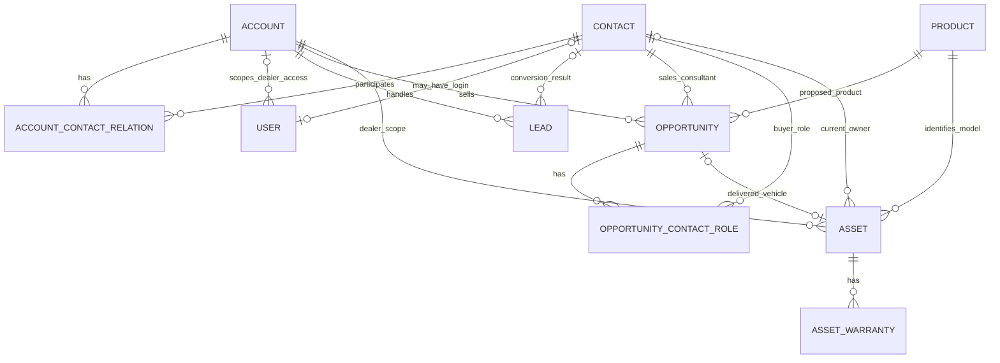
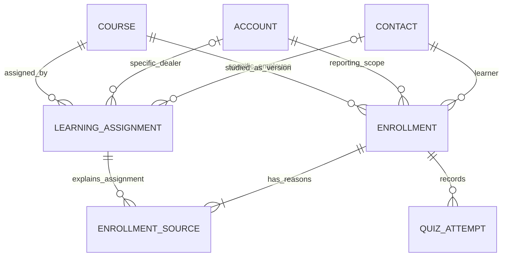

# 딜러포탈 공유 데이터모델과 업무 흐름

작성일: 2026년 10월 28일  
상태: 논리 설계 기준. 1차 구현과 샘플 데이터를 반영했으며, 실제 구현 범위와 남은 항목은 [구현 기록](04-shared-model-build.ko.md)에 정리했다.

## 1 설계 범위와 원칙

현대차 내부 관리 화면과 딜러포탈은 같은 업무 데이터와 서버 서비스를 사용한다. 화면과 메뉴는 역할에 따라 달라지고, 실제 조회·수정 권한은 서버에서 확인한다. 데모 로그인은 내부 사용자 1개와 딜러 영업직원 1개다. 딜러·직원·고객 데이터의 개수는 로그인 계정 수와 별개다.

이번에 정의할 것은 딜러와 사람, 영업과 차량의 관계, 학습 할당과 개인 성적, 지식 기반 텍스트 챗봇이다. Sales role play와 음성은 후속 범위다. 기존 계약 기능은 보존하되 자동 계약 추출을 이번 작업의 중심으로 확장하지 않는다.

배포 환경, SDK 언어, 인증 공급자와 최종 DB 제품은 보류한 상태다. 여기서는 기술 제품과 독립적인 관계형 논리 모델을 정의한다. 작은 레슨·퀴즈와 답안은 JSON으로 보관해 별도 문제·선택지 테이블을 만들지 않는다.

모든 id와 관계는 이름이 아닌 안정적인 ID로 연결한다. 1차 구현은 외래 키와 UNIQUE 제약을 적용하고 주요 변경에 조작 User의 감사 기록을 남긴다. 이 문서의 후속 업무 전체가 구현됐다는 뜻은 아니다.

현재 저장소의 AU 자료와 앞선 대화의 UK 교육 자료를 섞지 않는다. 딜러·제품·교육·지식 자료에 market_code를 명시한다. 실제 국가 변경이나 UK 자료 이관은 이 문서 작성만으로 실행하지 않는다. 첫 구현에서는 한 시장만 사용한다.

## 2 기본 개념과 Salesforce 대응

| 개념 | 이번 모델 | 의미와 경계 |
|---|---|---|
| 딜러 | Account | 딜러 사업장. Tier와 신규 여부를 관리하는 단위 |
| 딜러 직원과 최종 구매 고객 | Contact | 모두 사람. 딜러와의 관계 역할로 구분 |
| 소속과 거래 관계 | AccountContactRelation | Employee는 직원 소속, Customer는 해당 딜러가 응대하는 고객 관계 |
| 로그인 계정 | User | Contact와 별개. 로그인하지 않는 직원·고객도 존재 |
| 차종과 트림 | Product | 시장·모델연도·트림 등 제품 정의 |
| 개별 차량 | Asset | VIN으로 구별하는 실차. Product와 소유 고객을 참조 |
| 개별 차량의 보증 | AssetWarranty | 특정 Asset에 적용된 보증. 차량 1대에 여러 보증 가능 |
| 잠재 구매 문의 | Lead | 전환 전 문의와 전환 결과를 보존 |
| 판매 기회 | Opportunity | 판매 딜러·담당 영업직원·관심 제품·단계·금액 |
| 기회에 참여한 구매자 | OpportunityContactRole | 구매자·공동 구매자 등 Contact의 참여 역할 |
| 교육 요구와 대상 | LearningAssignment | 세그먼트·특정 Account·특정 Contact에 대한 학습 할당 |
| 개인 수강과 진도 | Enrollment | 직원 Contact에게 실제 배정된 과정과 이수 상태 |
| 개인 성적표 | QuizAttempt | 답안과 서버 채점 결과를 시도별로 보존 |

Salesforce의 Sales Overview와 Automotive Overview를 참고하되 모든 표준 객체를 복제하지 않는다. 학습 객체는 이 프로토타입의 자체 모델이며 Salesforce 표준 LMS 객체라는 뜻이 아니다.

판매 딜러와 구매 고객을 구분한다. Opportunity.dealer_account_id는 판매자 범위이며 구매자는 ContactRole로 연결한다. 이 필드를 Salesforce의 구매 조직 Account 관계와 무조건 같은 의미로 매핑하지 않는다. 기업 구매 Account와 Person Account는 초기 범위에 추가하지 않는다.

## 3 딜러와 사람 및 차량 관계

이 ERD는 이번 제안이며 Salesforce 공식 도표의 복제가 아니다. Opportunity의 담당 영업직원 Contact와 ContactRole의 구매자 Contact는 서로 다른 관계다.

### Account

필드: id, dealer_code, name, market_code, tier, lifecycle_status, onboarded_at, status.

- tier: TIER_1 / TIER_2 / TIER_3. 데모용 구분이며 현대차의 실제 등급 정의라고 주장하지 않는다.
- lifecycle_status: NEW / ESTABLISHED. 초기에는 내부 담당자가 명시적으로 관리한다. 영업 개시일 기준 자동 일수 계산은 추가하지 않는다.
- Tier와 신규 여부는 독립적인 속성이다. Tier 1이면서 NEW인 딜러도 가능하다.

### Contact와 AccountContactRelation

Contact: id, display_name, email, phone, status.  
AccountContactRelation: id, account_id, contact_id, relationship_role, job_role, is_active.

- EMPLOYEE 관계는 직원 소속이다. 그중 SALES_CONSULTANT 직무를 이번 학습 대상으로 한다.
- CUSTOMER 관계는 그 딜러가 응대하는 구매 고객이라는 뜻이다. 고객이 딜러에 고용됐다는 의미가 아니다.
- 동일인을 직원 테이블과 고객 테이블로 나누지 않는다. 필요하면 관계 역할을 추가한다.
- 구매 고객에게 직원 교육을 할당하거나 로그인 계정을 자동 생성하지 않는다.
- 초기 데모에서는 직원 1명당 유효한 고용 딜러가 1개다. 전근과 복수 고용의 학습 이력 이전은 후속 설계다.
- UNIQUE(account_id, contact_id, relationship_role). 이름만으로 중복을 판단하거나 이메일만으로 다른 사람을 자동 병합하지 않는다.

### User

필드: id, login_identifier, role, contact_id?, dealer_account_id?, status.

- INTERNAL_ADMIN은 내부 관리용이다. 딜러 직원 Contact 연결은 필수가 아니다.
- DEALER_SALES는 contact_id와 dealer_account_id가 필수다. 유효한 EMPLOYEE 관계와 SALES_CONSULTANT 직무를 확인한다.
- Contact당 유효한 로그인은 최대 1개다. 구매 고객은 로그인이 없다. 표시 이름을 사용자 식별자로 쓰지 않는다.
- 인증 공급자는 추후 선택하되, 사용자 role과 딜러 범위는 URL·요청 본문이 아닌 서버 세션에서 결정한다.

### Product와 Asset

Product: id, product_code, model_name, trim, model_year, market_code, status.  
Asset: id, vin, product_id, dealer_account_id, owner_contact_id?, delivered_from_opportunity_id?, delivery_date?, status.

- Product는 특정 사양의 차종이고 Asset은 그 사양의 실차다. VIN은 Asset에서 유일해야 한다.
- 소유 고객 Contact와 고객을 담당하는 직원 Contact를 같은 필드에 넣지 않는다.
- Asset.dealer_account_id는 판매·취급 딜러의 접근 범위다. 차량의 법적 소유자를 뜻하지 않는다.
- 문의나 열린 Opportunity만으로 고객 소유 Asset을 만들지 않는다. 기본 흐름에서는 인도 시 실제 차량을 등록하거나 연결한다.
- 초기에는 1 Opportunity에 차량 1대다. delivered_from_opportunity_id를 유일하게 하여 인도 중복 등록을 막는다. 복수 차량 주문은 후속 범위다.

### AssetWarranty

필드: id, asset_id, coverage_type, start_date, end_date, mileage_limit?, terms_snapshot, source_reference, status.

한 Asset에 차량 본체·고전압 배터리 등 여러 보증을 연결한다. 초기에는 적용 조건의 스냅샷을 각 보증 기록에 보관한다. 보증 템플릿을 반복 관리해야 할 때 WarrantyTerm과 Product 연결을 분리하며, 지금은 템플릿 관리 화면까지 만들지 않는다.

보증 종료일만으로 청구 가능 여부를 확정하지 않는다. 면책·주행거리·기타 조건을 포함한 실제 보증 판정은 자동화 범위가 아니다.

### Lead와 Opportunity

Lead: id, dealer_account_id, assigned_sales_contact_id, name, email?, status, interested_product_id?, converted_contact_id?, converted_opportunity_id?, converted_at?.  
Opportunity: id, dealer_account_id, sales_consultant_contact_id, product_id, stage, amount_minor?, currency_code, expected_close_date?.  
OpportunityContactRole: id, opportunity_id, contact_id, role, is_primary.

- Lead는 전환 전에는 Contact 참조 없이 존재할 수 있다. 전환 후 결과 Contact와 선택적으로 생성한 Opportunity를 참조한다.
- Contact와 Opportunity는 ContactRole로 연결한다. 초기에는 Primary Buyer를 1명 지정하고 공동 구매자를 추가할 수 있는 형태로 둔다.
- 담당 영업 Contact는 EMPLOYEE, 구매자 Contact는 CUSTOMER 관계가 있어야 하며 같은 판매 딜러의 범위인지 서버에서 확인한다.
- 금액은 최소 통화 단위의 정수와 통화 코드로 보관한다. 표시 문자열이 정본이 되지 않는다.
- Lead 전환, Closed Won, 차량 인도는 별개다. Closed Won만으로 Asset 소유권과 보증 시작을 확정하지 않는다.

## 4 학습 할당과 개인 기록

### 필요한 객체

| 객체 | 주요 필드 | 책임 |
|---|---|---|
| Course | id, course_code, version, title, status, lessons_json, quiz_json, pass_mark_percent, product_id?, market_code | 교재와 퀴즈의 공개 버전 |
| LearningAssignment | id, course_id, target_type, account_id?, contact_id?, criteria_json?, required, due_in_days, status, created_by | 누구에게 무엇을 학습시킬지 정의 |
| Enrollment | id, account_id, learner_contact_id, course_id, status, lesson_progress_json, first_opened_at?, completed_at? | 개인 수강과 진도 |
| EnrollmentSource | enrollment_id, assignment_id, assigned_at, due_at | 해당 수강이 배정된 이유 |
| QuizAttempt | id, enrollment_id, attempt_number, answers_json, grading_json, score, total, passed, submitted_at, request_id, source | 각 응시의 변경하지 않는 기록. source는 LIVE_SUBMISSION 또는 PREPARED |

이는 기능을 다섯 개 늘린다는 뜻이 아니다. 하나의 학습 할당·수강·성적 확인 흐름을 데이터 책임별로 나눈 것이다. 레슨·퀴즈·문제·선택지용 독립 마스터 테이블은 초기에는 만들지 않는다.

### Course는 공개 버전마다 한 행

- course_code는 지속되는 과정 코드, id는 특정 버전의 식별자다. UNIQUE(course_code, version).
- 공개된 본문·문제·정답·통과 기준은 덮어쓰지 않는다. 변경은 version을 늘려 새 행으로 공개한다.
- Draft / Published / Retired를 구분한다. 기존 수강은 원래 버전을 계속 참조한다. Retired는 새 할당을 막으며 기존 수강자의 열람과 성적 이력을 지우지 않는다.
- 새 버전을 필수화할 때는 명시적으로 재할당한다. 이전 합격을 새 버전 합격으로 자동 전환하지 않는다.
- 학습자 API는 문제와 선택지만 반환하며 quiz_json의 정답 키를 반환하지 않는다.

### LearningAssignment는 세 종류

| target_type | 대상 | 예시 |
|---|---|---|
| DEALER_SEGMENT | 조건에 맞는 Account의 유효한 영업직원 | tier = TIER_1 |
| ACCOUNT | 지정 Account의 유효한 영업직원 | Bristol 전체 영업직원 |
| CONTACT | 지정 직원 Contact | Olivia에게 충전 복습 할당 |

세그먼트 조건은 tier와 lifecycle_status의 허용 값만 받는다. 한 조건 안에서는 AND다. OR는 할당을 나누어 표현한다. 임의 SQL이나 복잡한 규칙 엔진은 만들지 않는다.

DEALER_SEGMENT는 criteria만, ACCOUNT는 account_id만, CONTACT는 contact_id만 가진다. 타입과 지정 항목이 모순되면 거부한다. 해당 시장의 Published Course에만 할당한다.

할당 상태는 DRAFT / ACTIVE / PAUSED다. 활성화한 할당의 과정·대상 조건·필수 여부·기한 정책은 이력을 위해 고정한다. 변경하려면 새 할당을 만들고 기존 할당의 신규 전개를 중지한다. PAUSED는 이미 생성한 수강의 의무와 점수를 취소한다는 뜻이 아니다.

### Account 할당을 Contact 수강으로 전개

1. 내부 사용자가 과정과 대상을 선택하고 대상 Account 수·직원 수를 미리 본다.
2. 저장 시 대상과 권한을 다시 확인한다. 유효한 영업직원만 열거하고 CUSTOMER 관계의 Contact는 제외한다.
3. 직원별 Enrollment를 upsert하고 EnrollmentSource를 추가한다.
4. UNIQUE(learner_contact_id, course_id)로 같은 버전의 이중 수강을 막는다. UNIQUE(enrollment_id, assignment_id)로 할당 이유 중복도 막는다.
5. 같은 과정이 Tier 1과 NEW 양쪽에서 오면 수강·진도는 하나, 이유는 두 개다.
6. due_at은 그 직원에게 배정한 시각 + due_in_days다. 취소되지 않은 수강의 여러 필수 할당 근거 중 가장 빠른 기한을 표시한다. 원래 규칙이 PAUSED라도 기존 할당 의무는 명시적 수강 취소 전까지 유지한다.
7. Account 속성 변경, 직원 추가, 할당 활성화 시 재적용한다. 초기에는 내부 화면의 할당 업데이트 버튼으로도 실행하며 정기 작업은 필수가 아니다.
8. 세그먼트에서 빠지거나 할당을 중지해도 기존 수강과 점수를 자동 삭제하지 않는다. 신규 전개를 중지한다. 기존 수강의 면제·취소는 내부 사용자의 명시적 조작과 감사 기록으로 관리한다.

Enrollment.account_id는 할당 당시의 보고 범위다. 초기에는 전근을 다루지 않으며 소속만 바뀌었다고 과거 수강의 account_id를 덮어쓰지 않는다. Source의 Assignment와 Enrollment가 같은 Course인지도 검증한다.

Enrollment의 필수 여부는 연결된 고정 할당 근거 중 required=true가 하나라도 있으면 참이다. CANCELLED 수강은 자동 재적용으로 되살리지 않고 내부 사용자가 명시적으로 복원해야 한다.

### 진도와 성적의 정의

- Enrollment.status: ASSIGNED → IN_PROGRESS → COMPLETED. CANCELLED는 내부 사용자의 명시적 취소다.
- 열람과 레슨 완료는 다르다. opened는 참여이고 완료 버튼은 학습자의 자기 확인으로 기록한다.
- 진도율 = (완료한 필수 레슨 수 + 퀴즈 합격이면 1) / (필수 레슨 수 + 1). 필수 레슨 전체 완료와 퀴즈 합격이 모두 있어야 COMPLETED다.
- QuizAttempt는 서버의 정답 키로 채점한다. LLM이 점수를 계산하지 않는다. score는 정답 수, total은 해당 버전의 문제 수다.
- 합격은 백분율을 반올림하기 전에 pass_mark_percent 이상인지 비교한다. 3문항·만점 합격으로 고정하지 않는다.
- 최신 점수·최고 점수·응시 횟수·합격 시각을 구분한다. 합격 이후 낮은 점수로 다시 응시해도 과거 합격과 이력을 지우지 않는다.
- QuizAttempt를 덮어쓰지 않고 attempt_number를 늘린다. 수강 안에서 번호를 유일하게 하고 request_id로 이중 제출을 막는다.
- 답안과 정답·오답 피드백은 응시 버전의 스냅샷에 연결한다. 문제를 바꿔도 과거 점수를 재계산하지 않는다.
- Overdue는 due_at과 미완료 여부로 계산하는 표시 상태다. IN_PROGRESS를 대체하는 정본 상태로 저장하지 않는다.

### Account와 Contact 보고

Contact 화면: 배정 과정, 이유, 기한, 진도, 최신·최고 점수, 전체 응시 이력과 합격 시각. 개인 학습의 정본은 Enrollment와 QuizAttempt다.

Account 화면: Tier, 신규 여부, 대상 직원 수, 필수 수강 건수, 완료·기한 초과 건수, 직원별 목록. 같은 Enrollment에서 집계하며 딜러 전체 완료를 Account에 수기로 넣지 않는다.

- 필수 수강 완료율 = 완료된 필수 Enrollment 수 / 취소를 제외한 필수 Enrollment 수.
- 전 과정 완료 직원 비율 = 필수 과정을 모두 끝낸 직원 수 / 필수 Enrollment가 있는 직원 수.
- 미할당 직원은 별도로 표시한다. 분모가 0이면 N/A이며 100%가 아니다.
- 평균 점수를 표시하면 집계 대상을 명시한다. 초기에는 과정별로 각 수강의 최신 점수 비율을 평균하여 응시가 잦은 사람이 과도하게 반영되지 않게 한다.

## 5 지식 기반 텍스트 챗봇

| 객체 | 주요 필드 | 용도 |
|---|---|---|
| KnowledgeArticle | id, article_key, version, title, body, source_url?, product_id?, market_code, audience, status, effective_from?, effective_to? | 공개한 근거 문서의 버전 |
| ChatSession | id, user_id, account_id?, product_id?, created_at | 사용자 본인의 대화 |
| ChatMessage | id, session_id, role, text, sources_json?, mode, model?, prompt_version?, created_at | 질문·답변과 출처 |

- KnowledgeArticle도 공개 버전마다 별도 행이다. UNIQUE(article_key, version). 초기에는 문서 전체를 사용하므로 별도 Chunk 테이블이 필요 없다.
- audience는 DEALER / INTERNAL / BOTH다. 시장·공개 상태·유효 기간·audience를 서버에서 제한한 후 검색한다.
- 소량 자료 검색부터 시작한다. 벡터DB나 관리형 검색 도입은 보류한다. 검색 방식과 관계없이 다른 시장 자료를 혼합하지 않는다.
- 레슨에서 기사를 참조하면 공개 시점의 KnowledgeArticle.id를 고정한다. 정답 키와 내부 운영 메모는 지식 검색 대상이 아니다.

### 질문 처리 흐름

1. 서버 세션에서 User, role, dealer_account_id를 읽는다.
2. ChatSession이 본인 소유인지 확인한다. 다른 사용자의 session_id는 사용할 수 없다.
3. 열람 가능한 KnowledgeArticle만 검색한다. 클라이언트가 지정한 제품·기사 ID도 검증한다.
4. 가져온 근거에 기반해 답변하고 기사 ID·버전·제목을 표시한다.
5. 출처 ID가 실제 검색 결과에 포함됐는지 서버에서 확인한다. 출처가 존재한다고 답변의 의미까지 정확하다는 뜻은 아니다.
6. 근거가 부족하면 확인이 필요하다고 답하고 미확인 수치와 조건을 보충하지 않는다.
7. 질문·답변·검색 출처의 버전·응답 모드를 보존한다. 필요한 실행 식별자와 모델·프롬프트 버전도 연결한다. API 키는 저장하지 않는다.

초기 챗봇은 교육 자료 Q&A만 한다. 고객 목록·계약 원문·개별 VIN 보증 데이터를 자동으로 모델에 전달하지 않는다. 개인 차량의 보증 판정이나 상업 기록 변경을 요청받으면 해당 조회·변경 기능이 아직 없다고 안내한다. 문서 내용은 데이터이지 권한이나 도구 사용을 바꾸는 명령이 아니다.

키가 없으면 기존 Prepared guidance를 쓸 수 있지만 live AI와 구분한다. 고정 예시 답변을 실제 AI 응답이나 역할극 평가처럼 표시하지 않는다.

## 6 내부 화면과 딜러포탈의 접근 권한

| 데이터와 조작 | INTERNAL_ADMIN | DEALER_SALES |
|---|---|---|
| Account와 Tier·신규 속성 | 파일럿 대상 전체 조회·관리 | 자기 딜러 기본 정보 조회만 |
| 직원 Contact | 대상 딜러 직원 관리 | 본인 프로필. 전체 직원 개인 성적 조회는 불가 |
| 고객 Contact·Lead·Opportunity | 파일럿 대상 조회·관리 | 자기 딜러 안의 본인 담당 데이터 조회·변경 |
| Product | 공개 관리 | 같은 시장의 공개 제품 조회 |
| Asset·AssetWarranty | 대상 딜러의 관련 정보 조회 | 같은 딜러이면서 본인 담당 고객·상업 기록과 연결된 데이터 조회 |
| Course와 정답 키 | 작성·공개·퇴역·정답 관리 | 본인 수강 버전의 본문·문제만 조회 |
| LearningAssignment | 대상 미리보기·등록·업데이트·취소 | 본인에게 적용된 이유와 기한 조회만 |
| Enrollment·QuizAttempt | Account별·Contact별 보고 | 본인 진도와 전체 성적 이력. 본인 답안 제출만 |
| KnowledgeArticle | 공개 관리. 열람은 audience에 따름 | 공개·같은 시장·DEALER/BOTH만 |
| ChatSession·ChatMessage | 본인 대화만. 집계에 대화 본문은 제외 | 본인 대화만 |

내부 관리자라는 이유만으로 직원의 개인 챗봇 대화 전체를 조회하는 기능은 초기에는 넣지 않는다. 대화 감사가 필요하면 목적·권한·기록을 별도로 정한다.

고객이 다른 딜러와도 관계가 있더라도 그 관계나 다른 딜러의 기회까지 반환하지 않는다. Contact의 관련 목록과 직접 ID 조회에도 동일한 범위 검사를 적용한다. 고객 담당 범위는 Opportunity.sales_consultant_contact_id에서 도출한다. 계약·차량·보증도 관련 부모를 따라 검증한다. 아직 Opportunity가 없는 고객의 딜러 사용자 화면 노출은 기본 거부하며, 필요하면 명시적인 담당자 필드를 추가한다.

공유 API는 로그인 여부 → 조작 권한 → 레코드 범위 → 반환 필드 순으로 검사한다. view=admin, 탭 이름, 클라이언트 role 선택은 권한의 증거가 아니다. ID를 알아도 다른 딜러·직원의 기록에 접근할 수 없어야 한다.

## 7 주요 데이터 프로세스

### 내부 사용자의 교육 공개와 할당

Draft Course 작성 → 본문·필수 레슨·문제·정답·통과 기준 검증 → Published 버전 고정 → 대상 세그먼트 선택 → 인원 미리보기 → Assignment 저장 → Enrollment와 Source 생성 → Account별 진도 조회.

공개와 할당은 별도다. 공개만 했다고 전 직원에게 필수화하지 않는다. 할당 생성은 재실행해도 중복되지 않아야 하며 저장을 트랜잭션으로 보호한다.

### 직원의 학습과 응시

User에서 Contact·Account 확인 → 본인 Enrollment 조회 → 레슨 열람 → 완료 확인 → 답안 제출 → 서버에서 해당 버전 채점 → QuizAttempt 추가 → Enrollment 재계산 → 개인 성적과 내부 Account 집계 반영.

기록 저장 후에 성공을 반환한다. 클라이언트의 score·passed·learner_contact_id는 점수나 본인 식별의 정본으로 사용하지 않는다.

### 영업에서 차량과 보증으로 연결

Lead 등록 → 구매 가능성 확인 → 기존 Contact 확인 또는 신규 생성 → Customer 관계 연결 → 필요하면 Opportunity와 Primary Buyer Role 생성 → Lead에 전환 결과 기록 → 단계 진행 → Closed Won → 별도 인도 조작 → Product에 맞는 Asset을 구매자에게 연결 → 확인된 조건으로 AssetWarranty 등록.

전환은 같은 트랜잭션에서 처리하고 재요청해도 Contact·Opportunity를 이중 생성하지 않는다. 인도도 기존 Asset 연결을 확인해 중복 실행을 막는다. 구매자를 로그인한 영업직원 Contact로 대체하지 않는다. AI 문장만으로 판매·인도·보증 등록이 완료됐다고 표시하지 않는다.

이 영업 흐름은 관계를 정의하는 대상이다. 첫 버전에서 모든 쓰기 화면을 만들 필요는 없고, 가상 관련 데이터를 조회할 수 있으면 된다.

## 8 최소 데모 데이터

| 종류 | 예시 | 목적 |
|---|---|---|
| Account 2개 | Dealer A: Tier 1·Established / Dealer B: Tier 2·New | 대상 할당과 딜러 데이터 분리 |
| 직원 Contact 3개 | Olivia·Ben은 A, Priya는 B | 개인 성적과 Account 집계 구분 |
| 구매 고객 Contact 2개 | A·B에 각각 가상 구매자 | 직원과 고객 구분, 기회·차량 연결 |
| User 2개 | 내부 admin / Olivia에 연결된 dealer user | 실제 로그인 두 종류 |
| Product·Asset·보증 | 차종 1개, 가상 차량 2대와 보증 | 차종·실차·보증 관계 |
| Lead·Opportunity | 미전환 Lead와 전환된 판매 예시 | 전환과 구매자 연결 |
| Course | EV 기초, 충전 지식 두 과정 | 레슨·퀴즈·재응시 |
| Assignment | Tier 1, New, Olivia 직접 지정 | 조건 할당과 개별 할당 |

다른 Contact에게는 로그인을 만들지 않는다. 보고서용 가상 응시 이력은 prepared data로 식별하고 실제 제출 이력과 혼동하지 않는다.

중복 조건 검증에서는 B를 Tier 1로 바꾸어 같은 과정을 Tier 1·New 양쪽에서 할당한다. Priya의 Enrollment는 1개, Source는 2개여야 한다. 두 번째 딜러 로그인 없이도 서비스 계층에서 이 결과와 데이터 분리를 테스트할 수 있다.

## 9 현재 코드와 차이 및 이행 순서

| 현재 | 변경할 설계 |
|---|---|
| domain.ts의 고정 Opportunity 배열과 고객명 | Account·Contact·Opportunity·ContactRole ID 참조 |
| training_events.learner가 Jamie Taylor 고정 | 세션 User에서 Contact를 확인하고 Enrollment 연결 |
| 공개 Course를 전원에게 표시 | 본인의 Enrollment에 따른 버전 표시 |
| 3문항·만점 합격 고정 | Course 버전별 문제 수와 통과 기준 |
| opened와 quiz_submitted 이벤트만 존재 | 참여·레슨 진도·수강·성적 구분 |
| view=admin으로 관리자 데이터 반환 | 서버 role·레코드·필드 권한 검증 |
| AU 가이던스 배열 검색 | 시장·공개 상태·audience를 가진 기사 검색 |
| 챗봇 대화는 화면 메모리 중심 | 본인 Session·Message와 출처 버전 저장 |
| 브라우저의 정적 프리뷰도 데이터 변경 가능 | 프리뷰는 화면 예시. 공유 DB·권한을 검증하는 본체와 구분 |

구현 순서:

1. User·Account·Contact·관계와 서버 접근 경계. 두 데모 계정과 여러 딜러의 참조 데이터 준비.
2. Course 버전·Assignment·Enrollment·Source·QuizAttempt 연결. 내부 할당 → 직원 학습 → 내부 집계 완성.
3. KnowledgeArticle·ChatSession·ChatMessage 연결. 열람 가능한 지식으로 Q&A 완성.
4. Product·Asset·보증·Lead·Opportunity의 관련 조회 추가. 전환·인도 쓰기는 작은 후속 작업으로 분리.

기존 contracts와 audit_events는 삭제하지 않는다. Contract.opportunity_id를 실제 Opportunity에 연결한다. 계약서의 이름·금액 JSON은 문서 스냅샷이며 Contact 마스터나 매출 자체가 아니다.

기존 training_events의 이름을 추측으로 새 Contact에 연결하지 않는다. 명시적으로 매핑되는 이력만 옮기고 나머지는 legacy로 보존한다. 이름을 Olivia로 치환해 과거 점수를 다른 사람에게 넘기지 않는다.

## 10 수용 기준

- 내부·딜러 User가 같은 Course·Enrollment·Attempt를 사용하고 한쪽의 업데이트가 다른 쪽의 적절한 화면에 반영된다.
- Tier 1·New·Account 지정·Contact 지정의 대상이 설명 가능하고 구매 고객은 직원 교육에 포함되지 않는다.
- 동일 과정 중복 조건에서 수강은 하나이고 할당 이유는 모두 남는다.
- 새 Course 버전이나 재응시가 과거 점수·정답·답안을 덮어쓰지 않는다.
- 개인 성적과 Account 집계의 분모를 확인할 수 있고 미할당·미응시를 합격 처리하지 않는다.
- 딜러 사용자가 다른 딜러 ID·직원 Enrollment·Attempt·관리 API를 직접 지정해도 조회·변경되지 않는다.
- 학습자 응답·검색 문서·브라우저 초기 데이터에 정답 키가 없다.
- 로그인 직원, 구매 고객, 차량 소유 Contact를 혼동하지 않는다.
- 챗봇은 본인의 대화와 허용된 기사만 사용하고 근거 부족을 표시한다. 출처 ID는 실제 검색 자료와 대응한다.
- 역할극·음성·개별 보증 판정이 이미 구현된 것처럼 표시하지 않는다.

## 11 참고 자료

- [Salesforce Sales Overview Data Model](https://developer.salesforce.com/docs/platform/data-models/guide/sales-cloud-overview.html): 공통 Sales 객체와 관계.
- [Salesforce Automotive Overview Data Model](https://developer.salesforce.com/docs/platform/data-models/guide/automotive-cloud-overview.html): 차량·제품·Contact·보증 관계.
- [Salesforce Asset field reference](https://developer.salesforce.com/docs/platform/field-reference/references/field-reference/salesforce-field-reference-asset.html): Product와 Contact 등의 참조.
- [Salesforce AssetWarranty field reference](https://developer.salesforce.com/docs/platform/field-reference/references/field-reference/salesforce-field-reference-assetwarranty.html): 개별 Asset 보증과 조건.
- [Salesforce OpportunityContactRole field reference](https://developer.salesforce.com/docs/platform/field-reference/references/field-reference/salesforce-field-reference-opportunitycontactrole.html): 기회와 Contact의 역할 관계.
- [Salesforce Lead conversion](https://developer.salesforce.com/docs/platform/change-data-capture/guide/cdc-standard-objects-lead-conversion.html): 전환 결과 Contact와 선택적 Opportunity의 참조.

위 자료는 참조 모델이다. 이번 DB 필드·학습 관리·권한·보증 모델의 간소화는 프로토타입 설계이며 Salesforce 표준 기능을 그대로 이식한다는 뜻은 아니다.
